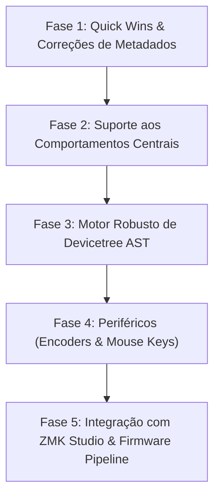

# Relatório de Auditoria: Recursos do ZMK Firmware vs. Aplicação Keymap Editor & Plano de Melhorias

Este documento apresenta o levantamento completo de todos os recursos, subsistemas e comportamentos disponibilizados pelo **ZMK Firmware**, avalia a aderência e cobertura da base de código desta aplicação (**Keymap Editor**) e estabelece um plano estruturado de melhorias para aproximar a ferramenta do estado da arte do ecossistema ZMK.

---

## 1. Visão Geral e Contexto da Base de Código

A aplicação sob análise é uma ferramenta visual (React + Node.js/Express) criada originalmente por Nick Coutsos para edição de mapas de teclas ZMK. Conforme indicado no histórico e documentação (`README.md` e `old-readme.md`), o código-fonte presente neste repositório representa um **snapshot legado (estabilizado em meados de 2020)**.

### Características da Implementação Atual no Repositório:
- **Dependência de Formato Duplo**: Exige ou gera um arquivo intermediário `config/keymap.json` e `config/info.json` além do arquivo `.keymap`.
- **Parser por Expressões Regulares**: O parser de árvore de dispositivos (Devicetree) no backend (`api/services/zmk/keymap.js`) utiliza expressões regulares simplificadas (`/bindings = <([^>]+)>/`), o que restringe o parsing a estruturas estritas.
- **Conjunto Estático e Antigo de Metadados**: Comportamentos e keycodes estão definidos em arquivos JSON estáticos (`api/services/zmk/data/zmk-behaviors.json` e `zmk-keycodes.json`), contendo apenas 19 comportamentos básicos.
- **Camada de Apresentação**: A interface web (`app/src`) renderiza o teclado em coordenadas 2D baseadas no `info.json` e permite alterar o comportamento e parâmetros através de um seletor fuzzy (`ValuePicker`).

---

## 2. Matriz Comparativa de Recursos (ZMK Firmware vs. Aplicação)

| Categoria | Recurso ZMK Firmware | Na Aplicação Atual | Nível de Suporte | Detalhes / Limitações |
| :--- | :--- | :--- | :---: | :--- |
| **Básico** | `&kp` (Key Press) | Sim | **Total** | Keycodes padrão HID suportados. |
| **Básico** | `&none`, `&trans` | Sim | **Total** | Suportados como teclas transparentes/nulas. |
| **Camadas** | `&mo` (Momentary Layer) | Sim | **Total** | Alterna camada enquanto pressionado. |
| **Camadas** | `&to` (To Layer) | Sim | **Total** | Ativa uma camada e desativa as demais. |
| **Camadas** | `&tog` (Toggle Layer) | Sim | **Total** | Liga/desliga uma camada específica. |
| **Camadas** | `&sl` (Sticky Layer) | Sim | **Básico** | Sem ajuste de timeouts ou release states. |
| **Modificadores**| `&sk` (Sticky Key) | Sim | **Básico** | Suporta modificadores simples, sem `ignore-modifiers`. |
| **Modificadores**| Modificadores Compostos (ex: `LC(RA(TAB))`) | Parcial | **Limitado** | Suporta apenas um nível simples de modificador (`mod(code)`). |
| **Modificadores**| `&kt` (Key Toggle) | Não | **Ausente** | Tecla de trava de modificador/tecla não existe no JSON. |
| **Taps / Holds** | `&lt` (Layer-Tap) | Sim | **Básico** | Alterna camada no hold e envia tecla no tap (sem configs avançadas). |
| **Taps / Holds** | `&mt` (Mod-Tap) | Sim | **Básico** | Modificador no hold e tecla no tap (sem configs avançadas). |
| **Taps / Holds** | Custom Hold-Tap (`zmk,behavior-hold-tap`) | Não | **Ausente** | Sabores (`balanced`, `tap-preferred`, `hold-preferred`), `tapping-term-ms`, `quick-tap-ms`, `retro-tap` não configuráveis. |
| **Taps / Holds** | Positional Hold-Tap (`hold-trigger-key-positions`) | Não | **Ausente** | Essencial para home-row mods modernos; indisponível. |
| **Modos de Teclado**| `&caps_word` | Sim | **Básico** | Suportado sem configuração de `continue-list` ou mods. |
| **Modos de Teclado**| `&key_repeat` | Sim | **Básico** | Suportado sem configuração de parâmetros. |
| **Avançado** | Combos (`zmk,combos`) | Não | **Ausente** | O código atual não possui suporte a criar, editar ou salvar nós de combos no Devicetree. |
| **Avançado** | Macros (`zmk,behavior-macro`) | Não | **Ausente** | Sem suporte a sequências de comandos (`bindings`, `wait-ms`, `tap-ms`). |
| **Avançado** | Tap-Dance (`zmk,behavior-tap-dance`) | Não | **Ausente** | Ações diferentes por quantidade de toques não suportadas. |
| **Avançado** | Mod-Morph (`zmk,behavior-mod-morph`) | Não | **Ausente** | Modificação de tecla de acordo com mods ativos (ex: Shift+Backspace=Delete) ausente. |
| **Avançado** | Camadas Condicionais (Tri-Layer) | Não | **Ausente** | Ativação automática de Camada 3 quando 1 e 2 estão ativas (`zmk,conditional-layers`). |
| **Hardware** | Encoders Rotativos (`sensor-bindings`) | Não | **Ausente** | Não lê nem edita `&inc_dec_kp`, nem mapeia rotação horária/anti-horária por camada. |
| **Mouse / Pointing**| Mouse Keys (`&mmv`, `&msc`, `&mkp`) | Não | **Ausente** | Movimento de mouse, rolagem e clique de botões inexistentes no catálogo. |
| **Mouse / Pointing**| Trackballs / Trackpads (Cirque, PMW3610) | Não | **Ausente** | Subsistema de input (`CONFIG_ZMK_POINTING`) não contemplado. |
| **Conectividade**| Bluetooth (`&bt`) | Parcial | **Limitado** | Suporta `BT_SEL (0..4)`, `BT_NXT`, `BT_PRV`, `BT_CLR`. Faltam `BT_CLR_ALL`, `BT_DISC`. |
| **Conectividade**| Saída USB / BLE (`&out`) | Parcial | **Limitado** | Presente (`OUT_USB`, `OUT_BLE`, `OUT_TOG`), porém com descrições invertidas no JSON. |
| **Iluminação** | RGB Underglow (`&rgb_ug`) | Parcial | **Limitado** | Efeitos e brilho suportados; falta comando com parâmetros de cor `RGB_COLOR_HSB`. |
| **Iluminação** | Backlight (`&bl`) | Sim | **Total** | Comandos padrão `BL_ON`, `BL_OFF`, `BL_TOG`, `BL_INC`, `BL_DEC`, `BL_CYCLE`, `BL_SET`. |
| **Energia / Sistema**| External Power (`&ext_power`) | Sim | **Total** | `EP_ON`, `EP_OFF`, `EP_TOG` suportados. |
| **Energia / Sistema**| `&soft_off` (Deep Sleep manual) | Não | **Ausente** | Recurso moderno de economia e corte de energia ausente. |
| **Energia / Sistema**| Reset do Sistema | Parcial | **Desatualizado**| Usa o identificador legado `&reset`. No ZMK moderno foi renomeado para `&sys_reset`. |
| **Energia / Sistema**| Bootloader (`&bootloader`) | Sim | **Total** | Ativação do modo DFU/UF2 suportada. |
| **Internacional**| Layouts regionais (ABNT2, ISO, acentos) | Não | **Ausente** | Faltam mapeamentos de `zmk-helpers` e tabelas de teclas não-US (ex: `Ç`, acentos mortos). |
| **Firmware / Ops**| ZMK Studio (Edição ao vivo USB/BLE) | Não | **Ausente** | O app não se comunica com o protocolo RPC do ZMK Studio (WebHID). |
| **Firmware / Ops**| Download de Firmware Compilado | Não | **Ausente** | Faz commit no Git, mas não consome os artefatos `.uf2` gerados pela GitHub Action. |

---

## 3. Análise Crítica e Detalhada das Lacunas

### 3.1. Parsing e Fidelidade do Devicetree (`.keymap`)
- **Problema**: O arquivo `api/services/zmk/keymap.js` monta o código através de interpolação textual pura de templates (`{{ rendered_layers }}`).
- **Impacto**: Se um usuário possui um arquivo `.keymap` com definições de macros, combos, custom behaviors, diretivas `#define` ou cabeçalhos customizados, o Keymap Editor substitui o arquivo com base no template básico, podendo apagar ou corromper customizações avançadas pré-existentes.
- **Causa Raiz**: O parser depende de um modelo estrutural simplificado em vez de uma árvore sintática abstrata (AST) do Devicetree.

### 3.2. Ausência dos Recursos Mais Populares de Teclados Ergonômicos
A grande maioria dos usuários de ZMK utiliza teclados ergonômicos split (ex: Corne, Ferris Sweep, Sofle, Lily58, Glove80). Os recursos mais utilizados por essa comunidade são justamente os que faltam nesta versão:
1. **Home Row Mods (Positional Hold-Tap)**: `hold-trigger-key-positions` e tempos customizados de `quick-tap-ms` e `tapping-term-ms` são cruciais para evitar digitação acidental de modificadores nas teclas de descanso.
2. **Combos**: Permitir pressionar duas teclas adjacentes simultaneamente para gerar caracteres especiais (ex: `J+K` = `ESC` ou `F+D` = `Backspace`).
3. **Encoders Rotativos**: Ajuste de volume, zoom, navegação de abas e rolagem em teclados com potenciômetros/encoders rotativos.
4. **Conditional Layers (Tri-Layer)**: Abrir uma camada de configuração/mídia quando as camadas "Raise" e "Lower" forem pressionadas em conjunto.
5. **Mouse Keys**: Controle do cursor do mouse, cliques e rolagem diretamente pelo teclado.

### 3.3. Metadados e Nomenclatura Obsoleta
- O ZMK padronizou `&sys_reset` para diferenciar reset do sistema de reset de hardware de periféricos. O app ainda injeta `&reset`.
- Em `api/services/zmk/data/zmk-behaviors.json`:
  - `OUT_BLE` está incorretamente descrito como *"Prefer sending to USB"*.
  - `OUT_USB` está descrito como *"Prefer sending to the current bluetooth profile"*.
- Não há suporte para o comando moderno `BT_DISC` (desconectar de host específico) e `BT_CLR_ALL` (limpar todos os perfis).

---

## 4. Plano Estruturado de Melhorias

Abaixo estão organizadas as iniciativas recomendadas para modernizar esta aplicação, divididas em etapas lógicas de desenvolvimento.

---

### Fase 1: Quick Wins & Correções Imediatas (Baixa complexidade)
1. **Atualização do Dicionário de Comportamentos (`zmk-behaviors.json`)**:
   - Adicionar `&sys_reset` mantendo compatibilidade retroativa com `&reset`.
   - Adicionar `&kt` (Key Toggle).
   - Adicionar `&soft_off`.
   - Corrigir os textos de `OUT_BLE` e `OUT_USB`.
   - Adicionar `BT_DISC` (com parâmetro enum 0 a 4) e `BT_CLR_ALL` aos comandos de `&bt`.
   - Adicionar `RGB_COLOR_HSB` com parâmetros H, S, B ao `&rgb_ug`.
2. **Atualização da Tabela de Keycodes (`zmk-keycodes.json`)**:
   - Sincronizar com os keycodes mais recentes da documentação oficial do ZMK (incluindo novos consumer keys e controles de mídia modernos).

---

### Fase 2: Suporte aos Recursos Centrais de Keymap (Média complexidade)
1. **Editor de Combos (`zmk,combos`)**:
   - Criar interface visual para seleção de múltiplas teclas simultâneas.
   - Configuração de `timeout-ms`, camadas ativas (`layers`) e ação resultante (`bindings`).
2. **Editor de Macros (`zmk,behavior-macro`)**:
   - Interface no frontend para encadear toques de teclas (`&kp`, `&macro_press`, `&macro_release`, `&macro_tap`, `&macro_wait_time`).
   - Suporte a macros com 0, 1 ou 2 parâmetros.
3. **Camadas Condicionais (Conditional Layers / Tri-Layers)**:
   - Configuração visual: "Quando [Camada A] E [Camada B] estiverem ativas, ativar automaticamente [Camada C]".
4. **Configurador de Comportamento Customizado (Hold-Tap & Tap-Dance)**:
   - Permitir ao usuário criar behaviors personalizados com `tapping-term-ms`, `quick-tap-ms`, `flavor` e `hold-trigger-key-positions`.

---

### Fase 3: Reformulação do Motor de Devicetree (Média-Alta complexidade)
1. **Parser Sintático com Preservação de Contexto**:
   - Substituir a extração por regex ingênua por um parser estruturado (usando Tree-sitter para devicetree ou parser léxico em JS/WASM).
   - Permitir ler diretamente o `.keymap` do usuário sem obrigatoriedade de arquivo `keymap.json`.
   - Preservar comentários de código, blocos preexistentes e diretivas `#include` e `#define` ao salvar.
2. **Carregamento Direto no Navegador (Web File System Access API)**:
   - Suportar a abertura de pastas locais diretamente pelo navegador Chromium sem necessidade de rodar o servidor backend Express local para tarefas simples.

---

### Fase 4: Encoders Rotativos & Pointing Devices (Alta complexidade)
1. **Suporte a Encoders**:
   - Permitir adicionar "knobs" visuais no layout para encoders rotativos.
   - Mapear comportamentos de rotação horária e anti-horária (`sensor-bindings = <&inc_dec_kp C_VOL_UP C_VOL_DN>`) por camada.
2. **Suporte a Mouse Keys (`CONFIG_ZMK_POINTING`)**:
   - Incluir comandos `&mmv` (movimento de ponteiro), `&msc` (scroll) e `&mkp` (cliques: `LCLK`, `RCLK`, `MCLK`, `MB4`, `MB5`).

---

### Fase 5: Integração de Firmware e Ecossistema Moderno (Futuro)
1. **Download do Firmware Compilado via GitHub API**:
   - Monitorar a execução do GitHub Actions disparado pelo commit.
   - Disponibilizar na interface um botão direto para baixar o arquivo `.uf2` gerado assim que a compilação terminar.
2. **Exportação Visual de Keymaps**:
   - Gerar documentação visual / diagramas SVG das camadas (estilo *Keymap Drawer*) para inclusão automática no `README.md` do repositório do usuário.
3. **Compatibilidade com ZMK Studio**:
   - Avaliar integração com o protocolo RPC do ZMK Studio via WebHID para gravação em tempo real na memória não-volátil (EEPROM/Flash emulada) de teclados com ZMK Studio habilitado.

---

## 5. Conclusão

Embora a aplicação forneça uma excelente base ergonômica visual para edição de teclas simples (`&kp`) e alternância básica de camadas (`&mo`, `&lt`, `&mt`), ela cobre atualmente menos de **35% dos recursos do ZMK Firmware moderno**.

A implementação das **Fases 1 e 2** elevará a cobertura funcional para mais de **80% das necessidades diárias** de usuários de teclados customizados, tornando a ferramenta compatível com layouts modernos de alto nível.

