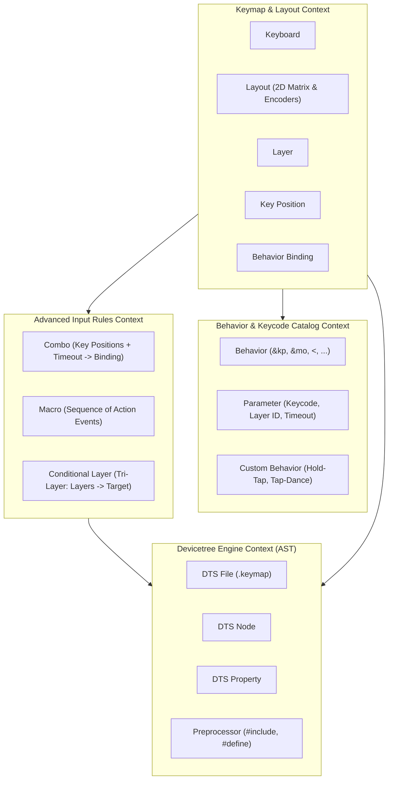

# 04 — Domain Model

Status: Approved

## 1. Bounded Contexts

---

## 2. Linguagem Ubíqua (Glossário Canônico)

- **Keycode**: Código numérico ou constante textual que representa um caractere HID, tecla modificadora, controle de mídia ou comando do sistema.
- **Behavior**: Módulo funcional do ZMK que define a semântica de uma tecla quando pressionada, solta ou mantida (`&kp`, `&mo`, `&to`, `&lt`, `&mt`, `&sk`, etc.).
- **Binding**: A aplicação de um Behavior associado a zero, um ou mais parâmetros específicos (ex: `&kp A`, `&mo 1`, `&lt 2 SPACE`).
- **Layer**: Camada lógica de layout onde cada posição física de tecla possui um Binding correspondente.
- **Hold-Tap**: Comportamento duplo que aciona uma ação (ex: modificador ou camada) se a tecla for segurada (*hold*) e outra ação (ex: caractere) se for tocada rapidamente (*tap*).
- **Positional Hold-Tap (`hold-trigger-key-positions`)**: Restrição em que o efeito de *hold* só é ativado se a próxima tecla pressionada pertencer a uma lista específica de posições (usado em *Home Row Mods* para evitar disparos acidentais com a mesma mão).
- **Combo**: Ativação de um Binding quando duas ou mais posições de teclas são pressionadas simultaneamente dentro de uma janela de tempo (`timeout-ms`).
- **Macro**: Sequência programada de eventos de pressionar, soltar, digitar ou aguardar (`&macro_press`, `&macro_release`, `&macro_tap`, `&macro_wait_time`).
- **Conditional Layer (Tri-Layer)**: Regra que ativa automaticamente uma terceira camada (ex: `Adjust`) quando duas camadas específicas (ex: `Lower` e `Raise`) estão ativas ao mesmo tempo.
- **Rotary Encoder**: Sensor giratório de hardware capaz de gerar eventos de incremento (sentido horário) e decremento (sentido anti-horário). Mapeado via `sensor-bindings = <&inc_dec_kp CLOCKWISE COUNTER_CLOCKWISE>`.
- **Pointing Subsystem**: Módulo ZMK (`CONFIG_ZMK_POINTING`) que emula mouse, rolagem e cliques (`&mmv`, `&msc`, `&mkp`).
- **Devicetree AST**: Estrutura em árvore de nós e propriedades que representa fielmente o arquivo `.keymap` sem perda de comentários ou diretivas pré-processadas.

---

## 3. Entidades e Agregados

### Aggregate Root: `Keymap`
- **Identificador**: `keyboard_name` + `keymap_id`
- **Atributos**:
  - `name`: string
  - `layers`: Lista ordenada de `Layer`
  - `combos`: Lista de `Combo`
  - `macros`: Lista de `Macro`
  - `conditional_layers`: Lista de `ConditionalLayer`
  - `custom_behaviors`: Lista de `CustomBehavior`
  - `sensor_bindings`: Mapa de `layer_id -> List<SensorBinding>`

### Entity: `Layer`
- **Atributos**:
  - `id`: integer / string
  - `name`: string
  - `bindings`: Lista indexada de `Binding` (tamanho = total de teclas do teclado)
  - `sensor_bindings`: Lista opcional de `SensorBinding` (tamanho = total de encoders)

### Entity: `Combo`
- **Atributos**:
  - `name`: string (identificador Devicetree válido)
  - `key_positions`: Lista de inteiros (mínimo 2 posições)
  - `timeout_ms`: integer (padrão: 50ms)
  - `layers`: Lista opcional de inteiros (camadas onde o combo é válido)
  - `binding`: `Binding`

### Entity: `Macro`
- **Atributos**:
  - `name`: string
  - `wait_ms`: integer
  - `tap_ms`: integer
  - `steps`: Lista de `MacroStep` (comando + binding)

### Value Object: `Binding`
- **Atributos**:
  - `behavior`: string (ex: `&kp`, `&mo`, `&hml`)
  - `params`: Lista de strings / inteiros (ex: `["LSHIFT", "A"]`)

### Value Object: `SensorBinding`
- **Atributos**:
  - `behavior`: string (geralmente `&inc_dec_kp`)
  - `cw_param`: string (ex: `C_VOL_UP`)
  - `ccw_param`: string (ex: `C_VOL_DN`)

---

## 4. Invariantes do Domínio

1. **Validação de Índices de Teclas**: As posições de `key_positions` de um Combo devem ser estritamente menores que a contagem total de teclas do teclado.
2. **Identificadores Devicetree**: O nome de qualquer Combo, Macro ou CustomBehavior deve seguir a regra C identifier (`^[a-zA-Z_][a-zA-Z0-9_]*$`).
3. **Consistência de Camadas**: O `then-layer` de uma `ConditionalLayer` não pode ser idêntico a nenhum dos `if-layers` (prevenção de loop cíclico).
4. **Preservação Não-Destrutiva**: Nós Devicetree não reconhecidos pelo modelo visual (ex: nós de pinagem de GPIO, displays, bluetooth profiles customizados) devem ser preservados integralmente na AST e reescritos inalterados na serialização.
