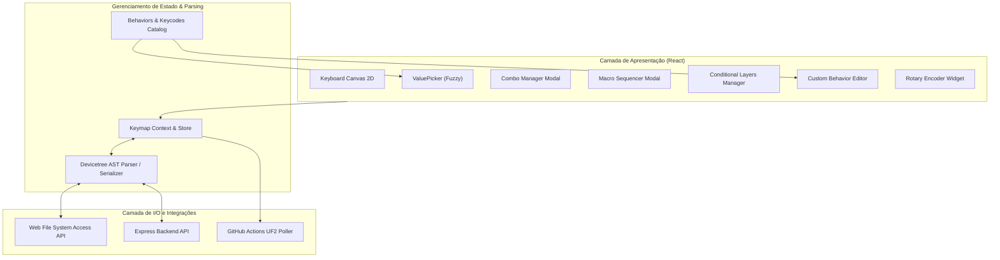

# 05 — Design & Decisões de Arquitetura

Status: Approved

## 1. Visão Arquitetural

A modernização adota uma estratégia de evolução modular em duas frentes:
1. **Camada de Metadados e UI (Fases 1 e 2)**: Enriquecimento das estruturas de dados e inclusão de interfaces especializadas (Combos, Macros, Conditional Layers e Custom Behaviors).
2. **Camada do Motor Devicetree e Hardware (Fases 3 e 4)**: Transição do modelo de regex baseado em string para um parser de AST Devicetree não-destrutivo e desacoplamento para client-side (Web File System Access).

---

## 2. Decisões Técnicas (DES)

### DES-001 — Estrutura Unificada de Metadados de Comportamentos
- **Related Requirements**: FR-001, FR-002, FR-003, FR-004, FR-005
- **Decision**: Expandir o esquema de `zmk-behaviors.json` para suportar tipagem rica de parâmetros (`enum`, `keycode`, `layer_id`, `number`, `hsb_color`), flags de compatibilidade (`deprecated: true`, `alias: "&sys_reset"`) e validação de limites (ex: 0 a 4 para perfis bluetooth).
- **Rationale**: A UI atual assume que quase todos os comportamentos recebem keycodes genéricos ou inteiros simples. Com parâmetros estruturados, a interface do `ValuePicker` pode renderizar seletores adequados (ex: sliders HSB ou listas de perfis BLE).
- **Trade-off**: Aumenta o tamanho do JSON de metadados, compensado por ser carregado sob demanda ou cacheado no cliente.

### DES-002 — Subsistema Visual de Combos
- **Related Requirements**: FR-006
- **Decision**: Criar um componente `ComboManager` acessível pelo menu superior do editor. Ao editar um combo, o teclado entra em modo de seleção múltipla de teclas com badges numéricos indicando a ordem e destaque visual das teclas vinculadas.
- **Rationale**: Usuários precisam ver graficamente a posição física das teclas que formam o combo para avaliar o conforto biomecânico (ex: adjacência de dedos).
- **Trade-off**: Exige alternar o estado do Canvas entre "modo de edição de tecla única" e "modo de seleção de combo".

### DES-003 — Sequenciador de Macros em Bloco
- **Related Requirements**: FR-007
- **Decision**: Implementar um editor de timeline linear para macros, onde cada passo é um bloco arrastável com ação (`tap`, `press`, `release`, `wait`) e parâmetros (`binding`, `delay_ms`).
- **Rationale**: Macros em Devicetree são propensas a erros de sintaxe quando escritas manualmente. Uma interface em blocos previne macros inválidas e calcula os tempos de atraso automaticamente.
- **Trade-off**: Requer gerenciar listas encadeadas de ações no estado do React.

### DES-004 — Modelagem de Camadas Condicionais (Tri-Layer)
- **Related Requirements**: FR-008
- **Decision**: Representar regras condicionais como tuplas `[Set<LayerId>, TargetLayerId]`. A serialização Devicetree agrupa todas as regras sob `/ { conditional_layers { ... }; };`.
- **Rationale**: Este é o padrão canônico do ZMK moderno, substituindo hacks antigos baseados em `&mo` encadeados.
- **Trade-off**: Nenhum; padrão nativo suportado em todo firmware ZMK recente.

### DES-005 — Editor de Custom Hold-Tap (Home Row Mods)
- **Related Requirements**: FR-009
- **Decision**: Disponibilizar um configurador de nós `zmk,behavior-hold-tap` com seleção interativa de teclas para `hold-trigger-key-positions` (clique no layout para marcar as teclas válidas, ex: metade oposta do teclado split).
- **Rationale**: Home Row Mods é a técnica mais popular em ergonomia, mas sem `hold-trigger-key-positions` e ajuste de `tapping-term-ms` ocorrem disparos acidentais frequentes.
- **Trade-off**: O modelo precisa sincronizar índices de teclas físicas com posições absolutas da matriz ZMK.

### DES-006 — Arquitetura de AST Devicetree Lossless
- **Related Requirements**: FR-010, FR-011, NFR-001
- **Decision**: Desenvolver um parser léxico baseado em gramática simplificada de Devicetree com suporte a *Trivia* (preservação de comentários e espaços) ou integrar um parser AST leve. Os nós parseados são classificados em:
  - *Gerenciados*: `keymap`, `layers`, `combos`, `macros`, `conditional_layers`, `behaviors`.
  - *Opacos (Preservados)*: Todos os demais nós, diretivas `#include`, `#define` e comentários.
- **Rationale**: A abordagem anterior por regex destruía qualquer customização prévia do usuário. O AST preserva 100% dos nós opacos.
- **Trade-off**: Maior complexidade algorítmica de parsing e serialização, coberta por testes unitários exaustivos.

### DES-007 — Suporte à Web File System Access API
- **Related Requirements**: FR-012
- **Decision**: Abstrair o acesso a arquivos através de uma interface de provedor (`IFileProvider`) com duas implementações: `LocalServerProvider` (Node/Express legado) e `WebFileSystemProvider` (nativo do navegador via `window.showDirectoryPicker`).
- **Rationale**: Permite que usuários utilizem o Keymap Editor diretamente em navegadores Chromium (Chrome, Edge, Brave) apontando para a pasta local do seu repositório de teclado sem precisar clonar, rodar `npm start` ou ter Node instalado.
- **Trade-off**: Navegadores que não suportam a API (Safari/Firefox) continuam usando o backend local Express.

### DES-008 — Renderização e Mapeamento de Encoders Rotativos
- **Related Requirements**: FR-013
- **Decision**: Se `info.json` declarar encoders ou se o `.keymap` contiver `sensor-bindings`, o layout renderiza botões rotativos com dois seletores por camada: rotação horária (`CW`) e anti-horária (`CCW`).
- **Rationale**: Usuários de teclados como Sofle e Corne com rotary encoders precisam de controle visual de suas funções sem editar o DTS na mão.
- **Trade-off**: Requer adaptação do componente `KeyboardLayout` para posicionar elementos de encoder fora ou na borda da grade padrão de switches.

### DES-009 — Integração do Subsistema Pointing (`CONFIG_ZMK_POINTING`)
- **Related Requirements**: FR-014
- **Decision**: Adicionar categoria dedicada "Mouse & Pointing" no `ValuePicker`, contendo comandos de movimento (`&mmv`), rolagem (`&msc`) e cliques (`&mkp`).
- **Rationale**: Com o merge oficial de pointing no ZMK, dezenas de teclados adicionaram trackballs e trackpads.
- **Trade-off**: O usuário precisa garantir que `CONFIG_ZMK_POINTING=y` esteja habilitado em seu `.conf` (o editor exibirá uma dica visual).

### DES-010 — Polling e Download de Firmware via GitHub API
- **Related Requirements**: FR-015, NFR-003
- **Decision**: Utilizar chamadas autenticadas pelo cliente à API do GitHub (`/repos/{owner}/{repo}/actions/runs`) para verificar o status do commit e disponibilizar botão de download do artefato `.zip`/`.uf2`.
- **Rationale**: Fecha a jornada do usuário dentro da ferramenta, eliminando a necessidade de abrir o site do GitHub para baixar o firmware.
- **Trade-off**: Depende da cota de requisições da GitHub API (60 req/h anônimo, 5000 req/h com token do usuário).

