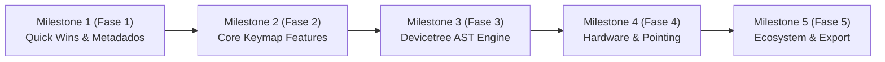

# 06 — Roadmap

Status: Approved

## Visão Geral dos Milestones

---

## Detalhamento dos Milestones

### Milestone 1 (M1) — Quick Wins & Correções Imediatas de Metadados
- **Escopo**:
  - Atualização completa de `zmk-behaviors.json` e `zmk-keycodes.json`.
  - Correção de `OUT_USB` e `OUT_BLE`.
  - Suporte a `&sys_reset` (com compatibilidade com `&reset`), `&soft_off`, `&kt`.
  - Comandos avançados de Bluetooth (`BT_DISC`, `BT_CLR_ALL`) e iluminação HSB.
- **Critério de Saída**: Validação automatizada de integridade dos arquivos JSON e testes no `ValuePicker` do frontend.

### Milestone 2 (M2) — Recursos Centrais de Keymap (Combos, Macros, Tri-Layer, Hold-Tap)
- **Escopo**:
  - Modal e seletor gráfico de Combos (`zmk,combos`).
  - Sequenciador de Macros (`zmk,behavior-macro`).
  - Painel de Camadas Condicionais (`zmk,conditional-layers`).
  - Editor de Custom Hold-Tap (Home Row Mods com `hold-trigger-key-positions` e parâmetros temporais).
- **Critério de Saída**: Cobertura de testes unitários para a geração de código Devicetree de cada um dos novos nós e demonstração visual na UI.

### Milestone 3 (M3) — Motor de Devicetree AST & Web File System Access
- **Escopo**:
  - Implementação do parser e serializer AST não-destrutivo para `.keymap`.
  - Preservação comprovada de comentários, `#define`, `#include` e nós customizados.
  - Integração da Web File System Access API para permitir uso 100% no navegador.
- **Critério de Saída**: Suíte de 20 keymaps reais públicos do ZMK processados em teste de round-trip com 100% de preservação semântica.

### Milestone 4 (M4) — Periféricos de Hardware (Encoders & Mouse Keys)
- **Escopo**:
  - Visualização de Rotary Encoders na UI do teclado.
  - Edição de `sensor-bindings` (horário/anti-horário) por camada.
  - Inclusão dos comandos de mouse keys (`&mmv`, `&msc`, `&mkp`) no catálogo e no `ValuePicker`.
- **Critério de Saída**: Teclado com encoder (ex: Sofle/Corne) salva e carrega corretamente `sensor-bindings` no Devicetree.

### Milestone 5 (M5) — Ecossistema ZMK, Download de Firmware e Exportação
- **Escopo**:
  - Polling e download direto de `.uf2` compilados via GitHub Actions API.
  - Exportação de diagrama SVG do layout estilo Keymap Drawer.
  - Prova de conceito de comunicação WebHID com ZMK Studio.
- **Critério de Saída**: Usuário autenticado faz commit e baixa o `.uf2` gerado sem sair da aplicação.

